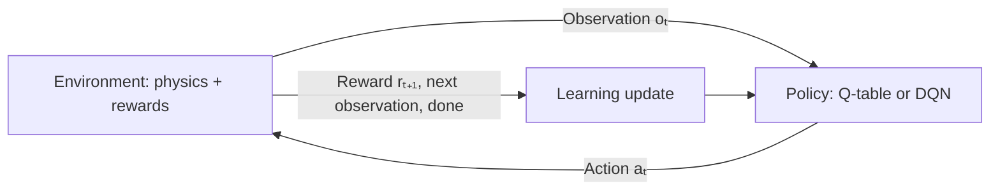
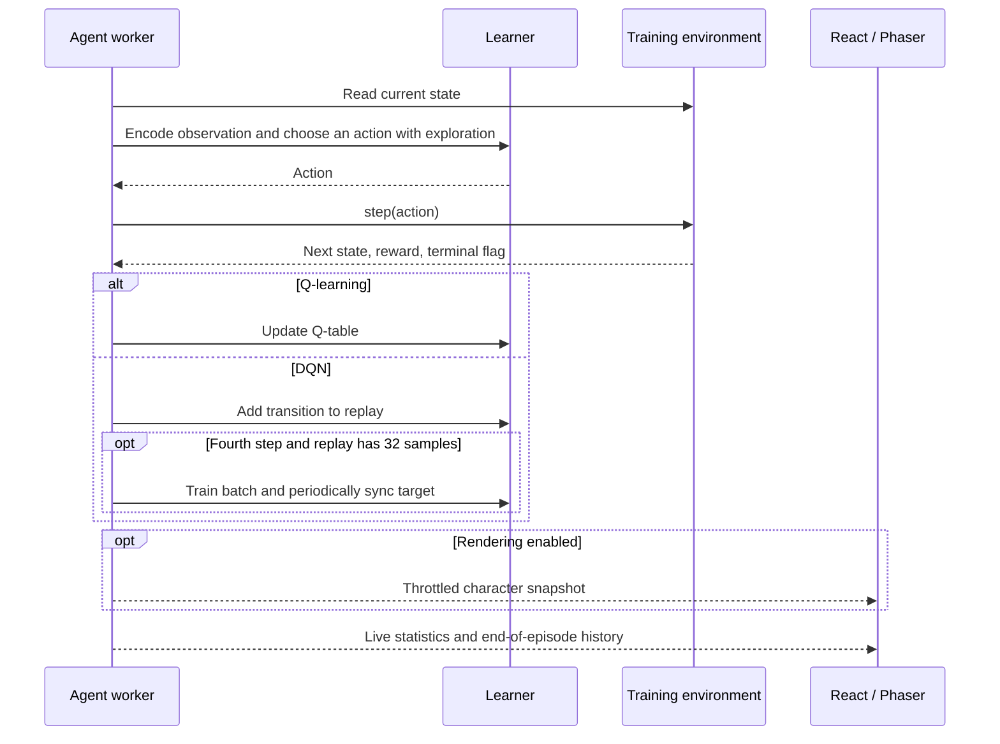
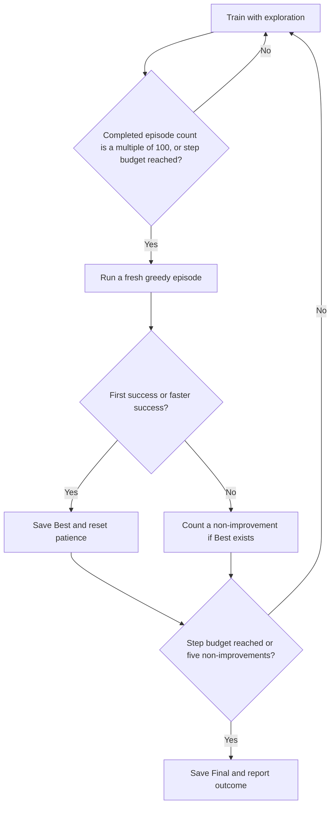

# Reinforcement learning in Zawgyi RL Platformer

Zawgyi learns actions through game interactions and rewards. There is no scripted
“jump here” route. Both learners are **model-free, off-policy value-based methods**:
they estimate action values without learning a model of the world's dynamics.
Q-learning's off-policy update is described in [Sutton and Barto, §6.5](https://people.cs.umass.edu/~barto/courses/cs687/Chapter%206.pdf);
the neural approach follows the replay/target-network ideas in the
[original DQN paper](https://doi.org/10.1038/nature14236).

## 1. The agent–environment loop

| RL concept | In this game |
| --- | --- |
| Agent | One Q-learning table or DQN model |
| Environment | Deterministic Himavanta simulator |
| Observation | Features derived from player position, movement, and next gap |
| Action | Idle, left, right, jump, jump-left, jump-right |
| Reward | Numeric feedback after each action |
| Episode | Spawn until goal, falling, or 1,200-step limit |
| Policy | Rule for selecting an action from estimated Q-values |
| Q-value | Estimated discounted future return for an observation/action |

One simulation step represents **1/60 second**, regardless of rendering or training speed.
Success requires being grounded at **x ≥ 1470**. Falling below **y > 590** or
reaching the step limit ends an unsuccessful episode.

The objective is expected discounted return, not merely the next reward:

$$
G_t = \sum_{k=0}^{T-t-1}\gamma^k r_{t+k+1}
$$

Here, **γ** discounts later rewards; **T** is the terminal step.

Expanded form:

$$
G_t = r_{t+1} + \gamma r_{t+2} + \gamma^2 r_{t+3}
+ \cdots + \gamma^{T-t-1}r_T
$$

- **Gₜ:** discounted future reward starting at time t.
- **rₜ₊₁:** reward received after the next action.
- **γ:** discount factor; later rewards receive progressively smaller weights when 0 < γ < 1.
- **T:** step when the episode ends.

Example: with three remaining rewards **2, 4, 10** and **γ = 0.9**:

$$
G_t = 2 + (0.9 \times 4) + (0.9^2 \times 10)
= 2 + 3.6 + 8.1 = 13.7
$$

## 2. What the agent observes

The learner receives features, not image pixels.

**Game constants** come from the level geometry and movement rules.

| Value | What it represents | Theory behind it | Example | How it informs the next move |
| --- | --- | --- | --- | --- |
| 1550 px | Level width | Expresses horizontal distances as fractions of the map width | At x = 775, progress is `775 / 1550 = 0.5` | DQN can learn to keep moving right through an early stretch of the level. |
| 420 px | Ground Y coordinate | Subtracting the character's Y gives a positive height above ground because screen Y increases downward | At y = 376, height above ground is `420 − 376 = 44` px | Height helps distinguish standing from being over a gap, where moving right can help reach the far side. |
| 180 px/s | Full horizontal movement speed | Maps full speed left and right to −1 and +1 | Moving left at full speed gives `−180 / 180 = −1` | DQN can use the current direction of travel when scoring whether to keep moving or reverse. |
| 1470 px | Goal X coordinate | Subtracting the current X gives the horizontal distance still to travel | At x = 1160, the goal input is `(1470 − 1160) / 1550 = 0.2` | With the goal close and no gap ahead, DQN can learn to walk the remaining distance. |

**Agent observation choices** define how measurements are scaled or encoded.

| Value | What it represents | Theory behind it | Example | How it informs the next move |
| --- | --- | --- | --- | --- |
| 300 px | Gap look-ahead scale | A 159 px jump across a 75 px gap leaves about 84 px for takeoff before the edge. This scale gives the agent information well before that window | 150 px ahead gives `0.5`. At 300 px or farther, the input is capped at `1` | A gap far ahead allows more walking. A nearby edge makes jump-right worth considering. |
| 100 px | Reference gap width | Converts gap widths to a common scale so the agent can distinguish hazards of different sizes | A 65 px gap gives `65 / 100 = 0.65` | A wider gap can require more forward travel in the air to reach the far side. |
| 220 px | Height scale relative to the ground | Covers the jump peak (~88 px above ground) and fall cutoff (~170 px below ground) without clipping either. A 100 px scale would clip falls deeper than 100 px to −1 | Jump peak: `88 / 220 ≈ +0.40`. Near fall cutoff: `−170 / 220 ≈ −0.77` | Near ground height and descending, continuing right can help Zawgyi land beyond the gap. |
| 450 px/s | Reference vertical speed | A normal jump reaches about 390 px/s vertically. A 450 px/s scale uses most of the input range while leaving some headroom. Faster falls clip to +1. Use a larger scale if those speeds need to be distinguished | At takeoff, `−390 / 450 ≈ −0.87` | At the same height, rising leaves more airtime than falling. This helps the agent time movement toward the landing platform. |
| 1 or 0 | Grounded flag | Indicates whether the character is on solid ground and can initiate a jump | Standing on a platform gives `1`. In midair it gives `0` | On the ground, jump-right can start a jump. In midair, right still moves Zawgyi toward the landing. |

| DQN feature | Normalization before clamping |
| --- | --- |
| Progress | x / 1550 |
| Distance to next gap | distance / 300 |
| Next gap width | width / 100 |
| Height above ground | (420 − y) / 220 |
| Horizontal velocity | vx / 180 |
| Vertical velocity | vy / 450 |
| Grounded | 1 or 0 |
| Distance to goal | (1470 − x) / 1550 |

Values are clamped to appropriate **[0, 1]** or **[−1, 1]** ranges.

**Tabular Q-learning** instead bins gap distance, gap width, height, vertical
velocity, and grounded state into a string key. Gap distance uses **10px bins
within ±120px** and **50px bins farther away**. It omits absolute map position,
allowing similar gap approaches to share learned values.

**Theory boundary:** the complete environment state also includes elapsed steps,
already-rewarded gaps, and furthest progress. These are absent from the observations,
and binning merges distinct situations. The observation is therefore not guaranteed
to be Markov: identical observations can have different future rewards. Standard
tabular convergence guarantees do not automatically apply to this implementation.

## 3. Rewards

Rewards are added together each step:

| Event | Reward | Example | Why it’s used |
| --- | --- | --- | --- |
| Time cost | −0.01 | Standing still for one step costs −0.01. | Discourages waiting and encourages finishing sooner. |
| Signed forward/backward displacement | 0.05 × Δx | Moving 3 px right adds +0.15. Moving 3 px left adds −0.15. | Encourages moving toward the goal and discourages backtracking. |
| New forward distance while grounded before and after the step | +0.02 × new distance | Reaching 3 px beyond the previous furthest position on foot adds +0.06. | Favors walking on safe ground and rewards new progress only once. |
| Actual jump takeoff | −0.5 | A jump from the ground costs −0.5 on the takeoff step. | Discourages unnecessary jumps while leaving useful jumps available. |
| Safely pass a gap's landing edge by 8px | +4 once per gap | The first time Zawgyi is grounded at or beyond x = 353 after the first gap, he earns +4. | Gives feedback for clearing each obstacle before the final goal. |
| Reach the stone | +100 | Reaching x = 1470 while grounded adds +100. | Makes reaching the stone the main objective. |
| Fall or timeout | −40 | Falling below y = 590 or timing out at 1,200 steps adds −40. | Discourages falling and running out of time. |

Example: walking 3px onto previously unvisited ground earns
**−0.01 + 0.15 + 0.06 = 0.20** before other bonuses.

- Moving backward subtracts progress reward.
- Revisiting ground cannot repeatedly earn the walking bonus.
- Jump cost applies once on takeoff, not on every airborne step.
- Goal completion and step efficiency must still be checked: higher reward alone
  does not prove better gameplay.

These are task-specific shaping rewards, not a proven policy-invariant shaping
scheme. Walking and jumping have equal horizontal speed.

## 4. Q-learning versus DQN

For a transition, both methods use a temporal-difference target:

$$
y =
\begin{cases}
r & \text{if terminal} \\
r + \gamma\max_{a'}Q_{\text{bootstrap}}(o', a') & \text{otherwise}
\end{cases}
$$

| Detail | Q-learning | DQN |
| --- | --- | --- |
| Representation | Map: binned key → six Q-values | Neural network: 8 → 64 ReLU → 64 ReLU → 6 |
| Update | Q ← Q + α(y − Q) | Adam minimizes mean squared error against targets |
| Bootstrap values | Current Q-table | Separate target network |
| Learning rate | α = 0.1 | 0.001 |
| Discount γ | 0.95 | 0.99 |
| Experience | Update from each transition | Replay buffer of up to 20,000 transitions |
| Optimization schedule | Every step | Every fourth step, once 32 samples exist |
| Target synchronization | Not applicable | Copy online weights every 250 optimizer updates |

DQN samples replay batches of 32 **with replacement**. Its implementation copies
current predictions into a target array and replaces the taken-action entry with
the TD target. The other action entries retain their current predictions.

Replay reduces sequential correlation; the target network slows changes to
bootstrap targets. Neither guarantees stable improvement. This is basic DQN,
not Double DQN or a policy-gradient algorithm.

### Exploration versus exploitation

Training uses **epsilon-greedy** selection:

- Probability **ε**: choose a uniformly random action.
- Otherwise: choose an action with the highest estimated Q-value.
- After each completed training episode:
  **ε ← max(0.05, ε × decay)**.

| Setting | Q-learning | DQN |
| --- | --- | --- |
| Initial ε | 1.0 | 1.0 |
| Decay | 0.997 | 0.995 |
| Minimum ε | 0.05 | 0.05 |

Q-learning randomly breaks greedy ties during training. Evaluation uses the first
highest-valued action; DQN also chooses the first maximum. Watch AI and evaluation
disable exploration.

## 5. One training step

There are **1/2/4/8 independent workers**, each with its own environment, learner,
replay buffer, and episode lifecycle. This is parallel independent learning,
not cooperative multi-agent RL or a shared policy.
Headless mode skips rendering/snapshots; it preserves learning rules.

## 6. Evaluation, best policies, and stopping

Each evaluation runs **one greedy episode** from the normal spawn with no
exploration, weight or table updates, replay insertion, or epsilon decay. Its
steps are separate from the **1,000,000 training steps per agent** allowed by
default. The per-episode limit remains **1,200 steps**.

| Evaluation result | Effect |
| --- | --- |
| First success | Save Best and start tracking improvement. |
| Faster success | Replace Best and reset the non-improvement count. |
| Tie or slower success | Keep Best and count one non-improvement. |
| Failure | Count one non-improvement only if a successful Best exists. |

Five consecutive non-improvements stop that agent. A run can reach the step
budget before any success. The user can then add training steps for unsolved
agents without discarding their in-memory learner or episode state.

Separate greedy results from exploratory rewards. A later policy can take
longer or fail even after an earlier success. On this deterministic level,
replaying one greedy policy tests the same starting condition. To compare
algorithms, train with independent seeds under the same step budget. In a
100,000-step pilot, none of the three Q-learning runs or three DQN runs reached
the goal in evaluation. The app's default budget is provisional.

## 7. Checkpoints and code map

SQLite stores `<runId>/<agentId>/best` after the first successful evaluation and
`<runId>/<agentId>/final` after automatic completion. The latest-run manifest
references these records. Watch AI prefers a successful Best and allows manual
selection of Final or another compatible policy. Loading stored DQN weights
starts with fresh replay and optimizer state.

| Source | Responsibility |
| --- | --- |
| [Game domain](src/modules/game/domain/) | Level, physics, reward and episode termination |
| [RL domain and application](src/modules/reinforcement-learning/) | Observations and evaluation |
| [Algorithms](src/modules/reinforcement-learning/infrastructure/algorithms/) | Q-learning, DQN and replay |
| [Trainer worker](src/modules/reinforcement-learning/infrastructure/workers/trainer.worker.ts) | Learning, evaluation schedule, stopping and checkpoints |
| [Policy persistence](src/modules/reinforcement-learning/infrastructure/persistence/checkpoints.ts) | Saved policies, compatibility and run manifest |
